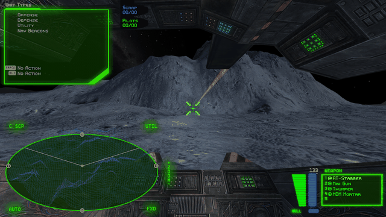
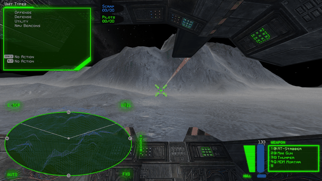
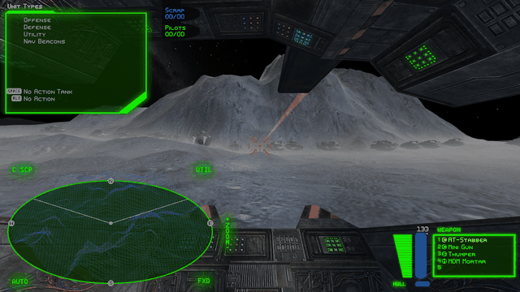
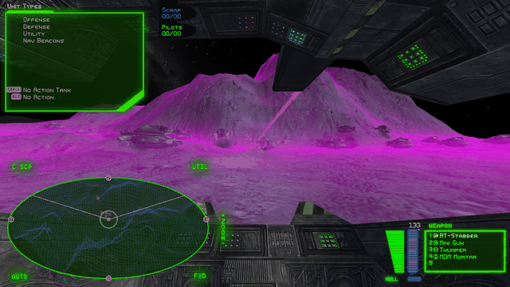

# Interactive ground fog wakes

Status (2026-09-07): simulation foundation and its runtime implemented, gated
off behind `[Experimental] InteractiveFogWakes`, and wired to live hovercraft
positions. **Nothing is rendered.** There is no GPU resource, no fog compositor
and no EXU API, so enabling the toggle changes no pixels; it exists so the
simulation can be observed and qualified before any GPU work is attempted. Not
released, and not visually qualified on any platform.

A render spike (2026-11-23, see **Render spike** below) was judged bad as
tuned and not merged. Rendering is parked until a screen-space or camera-local
approach is designed.

## First milestone

`include/fog_wake.h` and `src/engine/fog_wake.cpp` implement a platform-neutral
CPU clearance field in a fixed world-space rectangle. Cell centres store
clearance from zero (original fog) to one (cleared). Swept capsules connect
successive vehicle positions without gaps; a smooth radial edge softens the
corridor. Overlapping stamps take the maximum clearance, rather than accumulating
with the number of observations. Excessively long segments are rejected as
teleports. Wind transports clearance using bilinear backtracing; exponential
recovery restores undisturbed fog. Outside the region is zero clearance.

The default 128 x 128 grid at one metre per cell covers 128 x 128 metres. Two
float grids consume 128 KiB. Configuration caps each dimension at 1024. Updates
allocate no memory, and capsule stamping visits only a clipped bounding box.
Configuration allocates both buffers before replacing existing state; allocation
failure can throw and must be handled by the eventual runtime feature owner.

`Clearance()` exposes row-major samples for a future texture upload. It is not
a GPU texture or stable external ABI. All access must stay on one owner thread.
`Reset()` discards all disturbances; `Configure()` creates an empty region.

## Second milestone

`include/fog_wake_runtime.h` and `src/engine/fog_wake_runtime.cpp` drive the
field from emitter observations; `src/patches/fog_wake_feature.cpp` connects it
to the engine. This covers items 1 to 3 of the runtime contract below. Items 4
to 7 -- everything that puts a pixel on screen -- remain untouched.

The design problem is that the engine reports emitter positions from hooks on
the render path: any number of times per simulation step, once per camera, and
not at all on a frame with no emission. Advancing the field on observation would
make a wake's depth depend on frame rate and on how many cameras are active. So
observation does not simulate. `Observe` records where an emitter is now;
`AdvanceTo` takes a monotonic clock and steps a whole number of fixed ticks.
Calling it once per camera, or twice with the same timestamp, is a no-op by
construction rather than by the caller remembering a rule.

Within a tick, recovery and wind transport run before that tick's sweeps, so a
wake is written at full strength and decays from the following tick rather than
being decayed on the tick that created it.

The remaining behaviour is the failure modes item 2 calls for. A teleport is
rejected *and* reseeds the emitter's origin, because rejecting without reseeding
only delays the bogus streak by one tick. An emitter key is a raw engine pointer
and the allocator reuses those, so handle reuse trips the same distance check
and reads as a teleport. Emitters that stop reporting are dropped after a
staleness window, and the ceiling on tracked emitters refuses a newcomer rather
than evicting somebody else's history, since recycling a slot would attribute
one vehicle's wake to another. A session boundary clears emitters, field and
clock together. Pause absorbs wall-clock time without banking it; a long stall
is clamped rather than repaid as a burst; a clock that runs backwards simulates
nothing. `Configure` fails closed, including when the field configuration is
rejected.

### Engine wiring

| Concern | Site |
|---------|------|
| Emitter positions | the hovercraft engine-flame emit hook, which already sees a live craft with its identity in hand; position comes from the qualified `TryGetGameObjectWorldPosition` |
| Simulation cadence | the chunk-proxy render-queue submit, beside `TerrainProxyRenderFrameTick`. This runs **once per camera**, which is safe here only because `AdvanceTo` is idempotent within a tick |
| Session boundaries | `BzrSetRunningHook`, beside the existing headlight and pilot-flashlight notifications |

Hovercraft are the emitter set for now because that hook is the one place on the
simulation path that already yields craft identity and a qualified position.
Tracked vehicles that never emit engine flame therefore leave no wake. Widening
the emitter set is emitter policy, and belongs with the strength/width/height
gating in item 3.

Two placeholders are deliberate and must be replaced before anything renders.
The bank is latched to the **first emitter observed in a session** -- a region
centred on the world origin would sit nowhere near where a mission is played --
which satisfies "one fixed fog bank" but is not a considered placement. And no
wind source is wired, so transport is still: `AdvanceTo` is passed a zero wind
vector.

## Render spike

A throwaway spike to judge look and cost before designing the real renderer.
The code was not merged: it lives on branch `agent/fog-wake-render-spike`
(closed PR #966, `src/patches/fog_wake_render.cpp`,
`include/fog_wake_render_assets.h`). It is behind the same toggle, works on DX11 only, and fails
closed. Colour, density and heights are hard-coded. There is no EXU API, no
wind and no new config.

- **Clearance:** a manual Ogre texture (256x256 `PF_L8`, created once per
  process). Its D3D11 texture is fetched again on every upload, because
  device-loss recovery replaces it. It is refreshed with `UpdateSubresource`
  after each simulation step (64 KB).
- **Layers:** one `ManualObject` with four sections at 0.5, 1.5, 3.0 and 4.5 m
  above the terrain. Each section is a 129x129 grid at a 4 m step over the
  whole bank, sampled once per bank from `Terrain::HeightAt`. The shader draws
  `density x (1 - clearance)` with two octaves of drifting value noise, a
  grazing-angle path term, and fades at the bank edge, near the camera, and
  against stock fog.
- **Driver and lifecycle:** it is driven from `ChunkEffect::Simulate` after
  RtsMarkers, never inside render-queue traversal. `destroyAllEntities`
  destroys the layers; `clearScene` and `destroyAllMovableObjects` forget
  them.
- **Bank placement:** if no engine-flame emitter has been seen, the bank is
  placed around the local player, so fog exists before anything moves.
- **Toggle precedence:** an ini value (even `0`) wins over
  `OPENSHIM_INTERACTIVE_FOG_WAKES`. The shipped ini has the key at 0, so live
  tests must set the ini key.

Live result (lcbench, DX11, 1600x900 windowed, background run, 2026-11-23):

| Arm | FPS (mean of 5 s heartbeats after warm-up) |
|-----|------|
| quiet, toggle off | 236.9 |
| quiet, toggle on | 224.3 (-5.3%, about 0.24 ms/frame) |
| 20 hover tanks moving, toggle off | 203.6 |
| 20 hover tanks moving, toggle on | 175.9 (-13.6%, about 0.77 ms/frame) |

One earlier movement-on run stalled for about 10 s, at 0.8 fps for two
heartbeats. A repeat of that arm did not reproduce it, and no fog log line
coincided with it, so it is treated as a one-off. If it recurs, look at it
first.

Verdict: **bad as tuned**. The mechanism works: the texture, the layers and
the clearance all behave as designed. The look does not.

- **Density:** the fog is far too dense at a distance. The grazing path term
  turns the 512 m sheet into a white-out over the hills and horizon.
- **Terrain clipping:** the layers follow the terrain on a 4 m grid. On slopes
  the upper sheets cut through the hill and show hard, faceted patches.
- **Sorting:** the whole bank sorts at one depth (the bank centre), so it draws
  entirely before or entirely after other transparents (smoke, explosions).
- **Wake visibility:** wakes barely read. At about 50 m a passed column leaves
  at most a faint darker patch near the ground, not a trail, because the
  distant white-out dominates the frame.
- **Cost:** the cost grows with what is on screen (full-screen translucent
  overdraw of four sheets), not with the simulation.

What a real renderer would need:

- a camera-local mesh, or a screen-space ray-march against the depth buffer,
  instead of world sheets
- far lower density with distance fade
- per-pixel height relative to the terrain, not sheet geometry

## In-shader spike

Draft branch `agent/fog-wake-inshader-spike`. It replaces the world sheets with
a short ray-march inside the DX11 Enhanced per-pixel fog. It is a spike, not a
shipping feature.

How it works:

- Both `openshim_enhanced_terrain-sm4.hlsl` and `openshim_enhanced_base-sm4.hlsl`
  get the same block. It marches 6 samples along the eye ray, clipped to the
  bank box and to the scene depth.
- Density is `base * exp(-(y - terrainY) / H) * (1 - clearance) * noise`, with
  edge and near fades. `H` is 1.4 m, the top is 6 m and the far limit is 220 m.
- The mist colour mixes the atmosphere colour with a lit colour (ambient plus
  sun, mix 0.7). The atmosphere colour alone is near black on moon maps, which
  hid the mist in the first live run.
- `src/patches/fog_wake_shader.cpp` binds two textures with
  `PSSetShaderResources(32, 2)`. Slot t32 is a 5x1 RGBA32F parameter strip.
  Slot t33 is the 256x256 R16G16 bank: R holds clearance and G holds normalized
  terrain height. A magic value in texel 0 gates the effect, so an unbound slot
  reads 0 and the effect is off.
- It is off unless `[Experimental] InteractiveFogWakes` is on, and it runs on
  DX11 Enhanced only. Any other renderer fails closed.
- The texture upload, device-loss handling and bank placement come from the
  old spike. The ManualObject sheets are gone.
- When no mission start has been seen (for example on a command-line `lcbench`
  launch), the bank is placed around the player. It is not placed after a
  mission stop.
- Tuning comes from environment variables: `OPENSHIM_FOGWAKE_DENSITY`,
  `_SCALE_HEIGHT`, `_FAR` and `_LIT_MIX`. `OPENSHIM_FOGWAKE_DEBUG=1` paints the
  mist magenta.

FPS on `lcbench` (DX11, 1600x900 windowed, background launch). Each figure is
the mean of the `[SOAK]` 5 s heartbeats after skipping the first three
(n=14).

| Arm | Off | On | Change |
|-----|----:|---:|-------:|
| Quiet | 236.4 | 205.5 | -13% (~0.6 ms) |
| 20 hover tanks moving | 177.1 | 163.1 | -8% (~0.5 ms) |

The quiet-off figure looks capped near 237-238. The movement-off run was
noisy, with dips to 122 and 97, so both moving figures are rough. The
movement-on run used the build from before the placement fix, but its log
shows the bank was placed.

Frames (640x360):

| | Off | On |
|-|-----|----|
| Quiet |  |  |
| Tanks |  |  |

Debug colour, with tanks: 

Verdict:

- The render path works. There is no horizon white-out, terrain clipping or
  sorting issue, and the mist follows the slopes.
- It does not read as a low ground layer. Because the layer hugs the terrain
  everywhere, every hillside in view is milky. The scene reads as a general
  haze, and contrast drops.
- Wakes do not read. The debug view shows only faint holes near the tanks, not
  a trail at 30-80 m. The camera sits about 2.4 m up, inside the layer, so the
  mist in the foreground swamps the cleared cells further out.

Open problems before this could ship:

- A trail needs either a thinner layer, so the camera sits above it, or a
  clearance-weighted contrast term. Density tuning alone will not fix it.
- Density should fall off with slope or local relief, so hills are not hazed.
- There is no temporal accumulation, so 6-sample noise can crawl.
- The `fmod` time wrap makes the noise jump.
- The main-camera check uses `getCurrentViewport`. Its behaviour with other
  viewports has not been verified.
- The `ClearState` interaction with the t32/t33 bind has not been verified.
- A command-line `lcbench` launch never raises the mission-start edge. The
  player placement path works around this.
- The DXBC seed pack (`tools/build_dxbc_seed.py`) must be rebuilt before any
  merge. Without it, Enhanced players get cold shader compiles.

## Planned runtime contract

1. OpenShim owns a capability-gated runtime and all GPU resources. EXU will
   communicate mission intent; no new Lua API is claimed by this milestone.
2. Track valid vehicles and their prior world positions using qualified engine
   accessors. Clear tracking on destruction, handle reuse, session transitions,
   and teleports. A rejected sweep must still reseed the caller's prior position.
3. Advance recovery/wind, then stamp vehicle sweeps at a fixed simulation cadence.
   Render callbacks may execute for multiple cameras: never advance once per
   camera. Pause must freeze simulation time. Strength/width/height gating and
   optional stationary hover downwash belong to the emitter policy.
4. Start with one fixed fog bank. Moving a camera must not relocate its history.
   Scrolling/tiled fields, boundary crossfades and world-height profiles are later
   work. Radius should span multiple cells; sub-cell wakes may be undersampled.
5. Upload clearance once per update. A near-ground density function combines
   base fog, height, noise and `(1 - clearance)`. Integrate along the view ray up
   to opaque scene depth, not just at the visible surface position.
6. Qualify a scene-depth source and a pass before HUD/cockpit overlays. Coordinate
   stock fog so near fog is not already baked into the source colour. Transparent
   geometry, particles, water, alternate cameras and distant haze need explicit
   handling. Existing Ogre render hooks and terrain shader work are references,
   not proof that a suitable fog compositor insertion point has been verified.
7. Keep this optional and fail closed when rendering prerequisites are absent.
   Define DX9 fallback separately; do not assume DX11 integration proves it.

This foundation has wind drift and soft wake edges, but no vortices, displaced
density at wake edges, diffusion solver, terrain-height sampling, volumetric
lighting or particle curls. Semi-Lagrangian interpolation introduces numerical
diffusion and is not mass-conserving; fixed-step updates keep its look consistent.
Recovery without wind is independent of timestep partition.

## Validation

`fog_wake_tests` covers continuous sweeps, soft edges, idempotent overlap,
teleports, malformed inputs, invalid reconfiguration, exponential recovery,
timestep partition without wind, wind direction, outflow, bounds and reset.

`fog_wake_runtime_tests` covers the properties the runtime exists to guarantee:
that observation never simulates and never stamps; that repeated and per-camera
`AdvanceTo` calls do not multiply the simulation rate; that a partial tick is
banked rather than dropped or rounded up; that a stall is clamped instead of
replayed; that a backwards clock simulates nothing; that pause freezes
simulation time and resuming discharges no backlog; that a sweep carves a
continuous corridor between observations; that a teleport is rejected *and* its
streak never appears one tick later; that a recycled handle draws no wake across
the map; staleness eviction, the emitter ceiling, explicit destruction, session
transitions, malformed input and shutdown.

Both are registered in the shared CMake/CTest harness under the repo's `/W4 /WX`
convention, and both sources plus `fog_wake_feature.cpp` are in the Win32 DLL
project. The full suite is 26 tests and passes; the Win32 Release DLL builds
with no new warnings.

The simulation has no store, filesystem, loader, ABI or graphics dependency. The
runtime adds only a monotonic clock. With the toggle off, every engine entry
point is one relaxed atomic read.

In-game behaviour is **unverified on every platform**: Windows/GOG,
Windows/Steam, Linux/Steam Proton and Linux/GOG Wine/Proton. No game deployment
has been performed, and nothing renders, so there is nothing yet for a tester to
look at. Runtime qualification and tester validation in affected lanes are
required before release.
