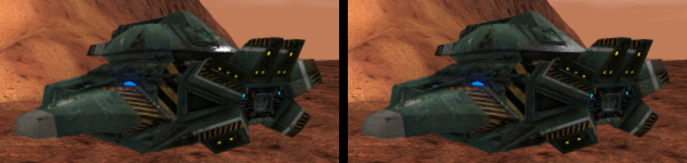

# Redux Grizzly: BZCC vs BZR Enhanced shading gap

Status: investigation + one prototype change (roughness mapping). Date: 2026-10-22.

## Question

The Redux Grizzly (`avtank.mesh`, material `avtank00`) looks noticeably better in
BZCC (Steam BZ2R, BZCC-R config, `BZCC-Redux-Grizzly` addon) than in BZR's DX11
Enhanced path. Why, and what shader/lighting changes close the gap?

Reference shots:

- BZCC: `BZCC-Redux-Grizzly/screenshots/grizzly_ivtank_override_*.png`
- BZR before/after: `Docs/images/redux_grizzly_shading/`

The full BZCC decode (objects, terrain, water; all 1,179 programs) is in
[bzcc_shader_reference/](bzcc_shader_reference/README.md).

## How the comparison was made

- BZR: `resources/renderer/enhanced/openshim_enhanced_base-sm4.hlsl` (the `OSE_*`
  object programs; CR's `CR_BZBase` binds to the same code) read directly, with
  the defines from `openshim_enhanced_base.program`.
- BZCC: the shipped compiled object pixel shaders
  (`dx11_default_psh_0pdtnesl`, `..._0pdtneslzo`) disassembled with
  `fxc -dumpbin`. No decompiler output is committed; the formulas below are
  paraphrased from the instruction stream.
- Inputs: GOG `avtank.material` (`$specular .7`, `$shininess 127`, DXT1 diffuse /
  normal / spec / emissive) vs the BZCC baked `ivgrzr00` material (diffuse 0.8,
  specular 0.2, specularPower 38.44, BC1-sRGB colour maps, BC5 normals).

## Both pipelines are linear-light, untonemapped

BZCC samples sRGB texture formats (DXGI 72), so its lighting is linear and the
swap chain encodes. BZR Enhanced decodes COLOR textures in-shader
(`OSE_LINEAR_LIGHT=1`) and encodes once at output. Neither applies a tone map,
and both use radial smoothstep-style fog. **Tone mapping, gamma and fog are not
the gap.**

## Findings, ranked by visual impact

### 0. Outside CR missions, the stock Grizzly never reaches Enhanced

Captured 2026-10-22 on the GOG install, stock `lcbmars.bzn`, Enhanced profile.
The scheme rewrite requests `en-high-pssm`. Stock `BZBase.material` has no
`en-*` technique, so OpenShim's enhanced scheme fallback uses the stock
`high-pssm` technique: `BaseHighPSSM_fragment` (`MAX_LIGHTS=8`, no
`ENHANCED_MODE`, no `OSE_LINEAR_LIGHT`, no IBL). That is gamma-space Blinn-Phong.

Only CR's `CR_BZBase` routes stock names to `OSE_Base*`, and CR (mapType
campaign / instant_action) is mounted only while one of its missions is being
played. So in stock missions none of the Enhanced findings below apply yet.
Making stock materials use Enhanced in every mission is being built separately
(`Docs/ENHANCED_RENDERER_MATERIAL_OWNERSHIP.md` Phase 1/2).

### 1. Specular lobe is ~15x too narrow (fixed in the prototype)

`legacy_shininess_to_roughness` returned `sqrt(2/(n+2))` and `distribution_ggx`
then squared it again into alpha. So the Grizzly's shininess 127 became
alpha = 2/(n+2) = 0.0155, clamped to the 0.12 perceptual floor -> alpha 0.0144.
Walter's Blinn-Phong->GGX equivalence (and BZCC's own shader) is
alpha = sqrt(2/(n+2)) = 0.125 for n = 127.

Effect: a pinpoint highlight peaking around 23x light intensity (it clips to
white and sparkles under motion), while the rest of the hull gets almost no
specular. BZCC's Grizzly works out at alpha ~0.22 and its sheen is a broad,
soft, Fresnel-driven lobe.

BZCC detail: alpha^2 = 2/(2^(specTex.a * matSpec.w) + 2). DXBC `exp` is base 2,
so the CPU stores log2(specular power) and this is exactly the Walter mapping.
For the Grizzly's specularPower 38.44 (about 5.26 in log2, at full spec alpha)
that gives alpha ~0.22. The CPU-side encoding is still to be confirmed with a
frame capture.

Prototype fix: return `sqrt(alpha)` so the squared value in the distribution is
the Walter alpha. Shininess 127 -> perceptual 0.354 (alpha 0.125); stock
`BZBase` shininess 32 -> 0.493 (alpha 0.243). The existing min/max clamps and the
normal-variance widening are unchanged. Only the object shader changes;
`openshim_enhanced_terrain-sm4.hlsl` has its own copy of the function, and
terrain shininess was tuned separately.

Risk: low. Every Enhanced object material gets broader, dimmer-peaked highlights.
Materials that were hand-tuned to a high shininess for a "wet" look will read
softer. CR's `CR_*` fork still has the old mapping, so
`scripts/Compare-EnhancedShaderParity.ps1` will flag the divergence until CR
picks up the same change.

### 2. No real environment term on the stock path

BZCC samples a per-world prefiltered sky sphere map
(`Worlds/*/Sky/*_environ.dds`, sRGB) along the reflection vector. The mip is
chosen from gloss, it is weighted by an analytic (Lazarov-style) EnvBRDF, tinted
by `g_EnvironmentColor`, and faded to the map average for downward reflections.
This is where the planet-coloured sheen on the BZCC hull comes from.

BZR's stock Enhanced programs do not define `IBL_ENABLED`. The fallback adds
only `sceneAmbient * fresnel * (1 - rough) * 0.2`. CR's `CR_static_ibl.program`
turns IBL on, but with neutral grey static cubemaps at 0.20/0.25 intensity and
only an 18% scene tint, so it reads as a flat grey reflection.

Recommendation, in order of effort:

1. Port BZCC's analytic EnvBRDF and use it in the non-IBL fallback with a
   hemisphere colour built from sky (fog/ambient) above and ground-ish ambient
   below. This is cheap and needs no new assets.
2. Raise the scene tint in the IBL path to ~0.6-0.8 so the cubemap takes the
   planet's colour.
3. Per-planet environment maps (bake from the skydome, or reuse BZCC's sphere
   maps where licensing allows), selected per world like BZCC.

### 3. Ambient and light colours are not decoded under linear light

Under `OSE_LINEAR_LIGHT`, the engine RGB constants (`sceneAmbient`,
`lightDiffuse`, `lightSpecular`) are passed through unchanged while textures and
fog are decoded. Gamma-authored ambient therefore reads too bright relative to
the sun, which flattens sun/shadow contrast. This is the open question in
`Campaign-Reimagined/Docs/DX11_COLOR_SPACE_AUDIT.md`.

A full sRGB decode overshoots: the decode's toe crushes dark ambient and shadows
go black. Recommendation: calibrate a partial decode (for example `pow(c, 1.6)`)
or a per-planet ambient scale against the BZCC shots, behind a define. BZCC also
multiplies ambient by `(1 - EnvBRDF)`, which darkens ambient on grazing,
reflective faces. Adopt that together with finding 2.

### 4. Diffuse is normalised ~14% darker

BZR's diffuse is `2.7/pi = 0.86 * L * NdotL * (1 - F)`. BZCC has no 1/pi, so it
uses 1.0. The direct sun on the hull is about 14% dimmer in BZR. Raising
`OSE_PBR_DIFFUSE_COMPENSATION` to pi would match, but terrain must move with it
(the terrain shader has its own constant), or vehicles will float visually.
Do it together with finding 3, since both change the overall exposure.

### 5. Normal-map sharpening amplifies DXT1 block artefacts

BZR multiplies normal-map XY by 1.85 at close range (`sharpen_normal_map`).
The GOG normals are DXT1, so this sharpens block noise as much as detail, and the
normal-variance filter then adds up to 0.35 roughness to hide it. BZCC uses BC5
two-channel normals with reconstructed z and no sharpening.

Recommendation: drop the factor to ~1.2-1.3 for objects. Longer term, re-encode
Redux normals to BC5 (an asset change, outside this repo's shaders).

### 6. No terminator softening on the geometric normal

BZCC multiplies each light by `smoothstep(saturate((geomN.L + 0.1) * 10))`, so
normal-mapped detail cannot light faces that point away from the sun. BZR has
nothing like it, so faces past the terminator get speckled with normal-map
highlights. Cheap to add: one dot product per light.

### 7. At parity, or not the cause

- Fog: both radial and smoothstep-shaped.
- Tone map: neither has one.
- Shadows: BZCC shadows only the first light. BZR's shadow floor
  (`shadow * 0.78 + 0.22`) is a little brighter, which is a style choice.

## Suggested order of work

1. Roughness mapping (this branch).
2. EnvBRDF and a tinted hemisphere fallback (finding 2.1), with ambient
   `(1 - EnvBRDF)` (finding 3, second half).
3. Normal sharpening down, plus the terminator smoothstep (findings 5 and 6).
4. Exposure pass: diffuse normalisation and calibrated ambient decode for
   objects and terrain together (findings 3 and 4).
5. Per-planet environment maps (finding 2.3).

Steps 2 and 3 should each get a before/after capture with the recipe below.
Step 4 needs a terrain parity check as well.

## Prototype results

Shots are in `Docs/images/redux_grizzly_shading/`. They come from the GOG
install on stock `lcbmars.bzn` (Mars, sun time 0900, fog 120-250) with the
Enhanced profile, captured by `reverse_engineering/capture_grizzly_reference.ps1`.

- `bzr_enhanced_before_*.jpg` show the stock material. The Grizzly falls back to
  stock `BaseHighPSSM_*` (finding 0).
- `bzr_ose_before_*` / `bzr_ose_after_*` are the A/B pair. For these runs only,
  CR's `avtank.material` and a trimmed `CR_BZBase.material` were overlaid into
  `BZ_ASSETS\pc\materials`, so the Grizzly took the `en-high-pssm` pass
  (`OSE_BaseENHighPSSMV2_vertex` / `OSE_BaseENHighPSSM_fragment`). The trim removed
  the CR-only `CR_BaseIBL*` overrides and renamed `CR_Textured_*` to `Textured_*`.
  The only difference between A and B is `legacy_shininess_to_roughness`. The
  shader cache was set aside, and its fingerprint changed, so the shaders
  recompiled. Every install file was restored and hash-verified afterwards.
- `bzr_ose_ab_*_crop3x.png` show the tank at 3x, before on the left and after on
  the right.

Result: the hot white glint along the turret rim and top edges becomes a
broader, softer sheen. In the `front_close` tank crop, pixels with luminance
above 150 fell from 1688 to 650 while mean luminance barely moved (68.7 to
68.5), so the energy is spread out rather than removed. This narrows the
biggest single gap. The planet-tinted environment sheen BZCC shows (finding 2)
is still missing.

## Follow-ups outside this change

- Apply the same mapping to CR's `CR_*` shader fork to restore parity.
- Decide whether terrain should adopt the same mapping. Terrain shininess values
  were tuned against the old curve.
