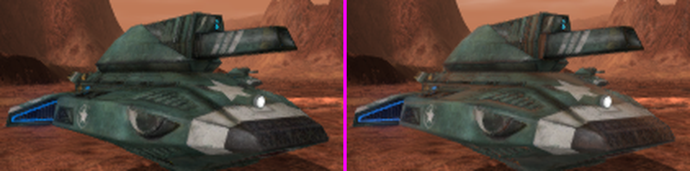
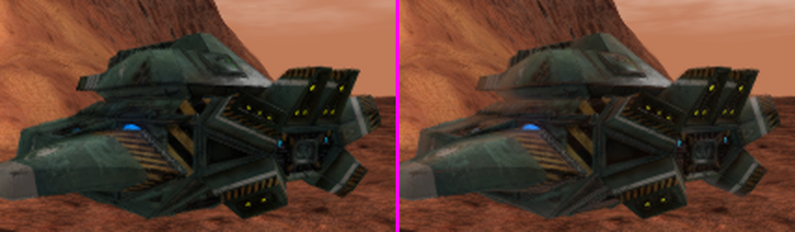
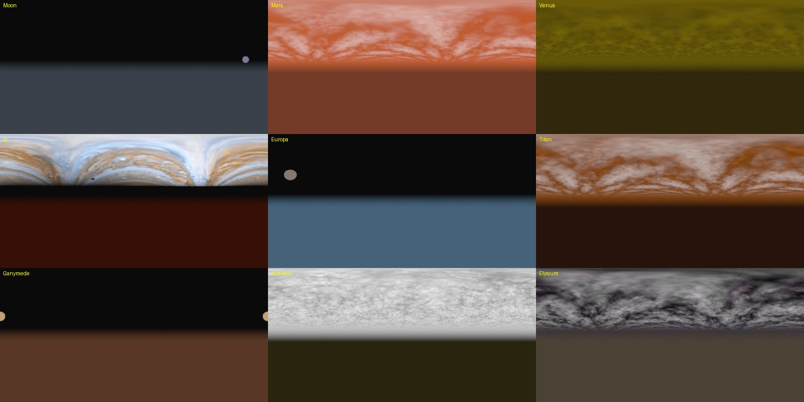
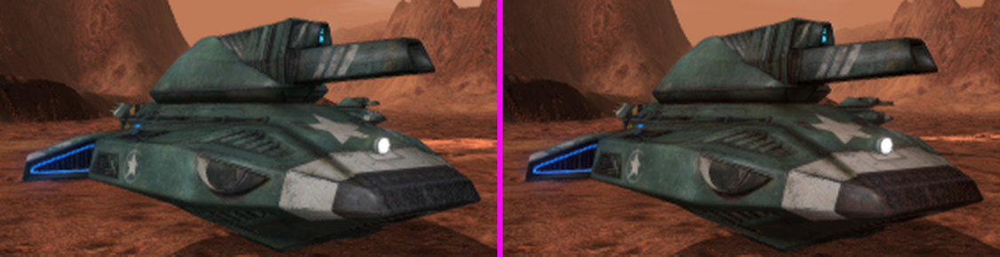
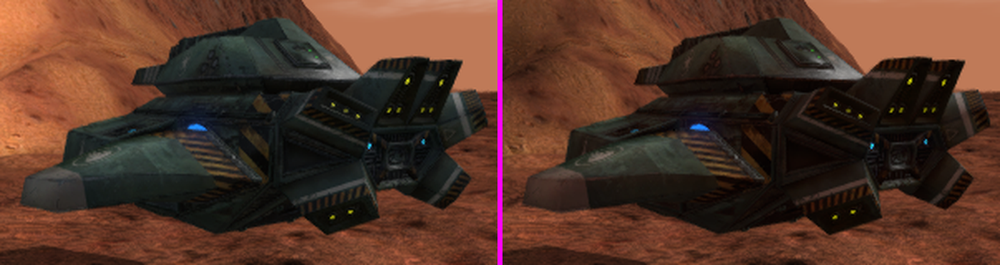
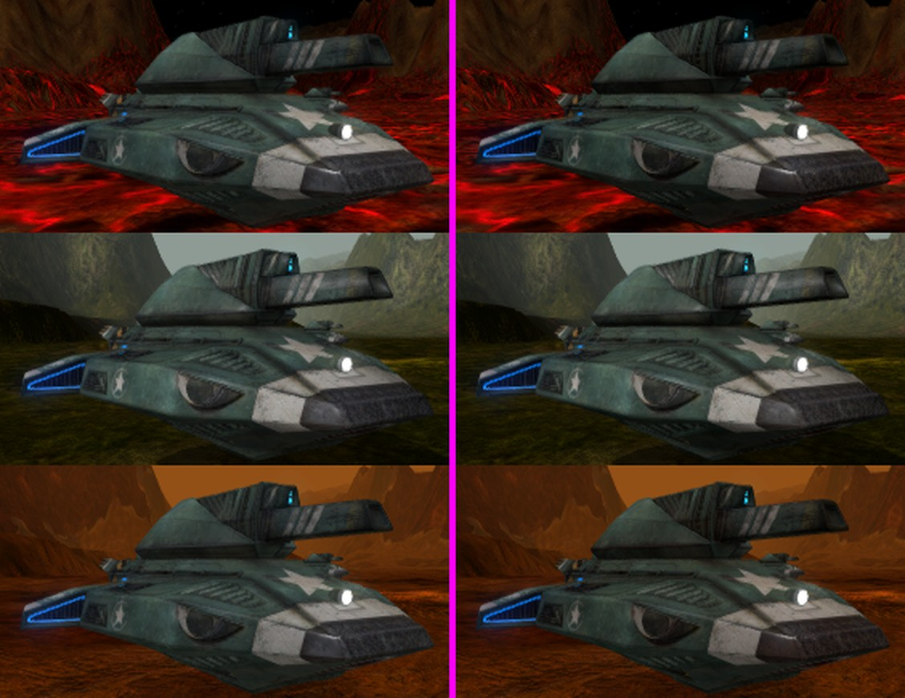
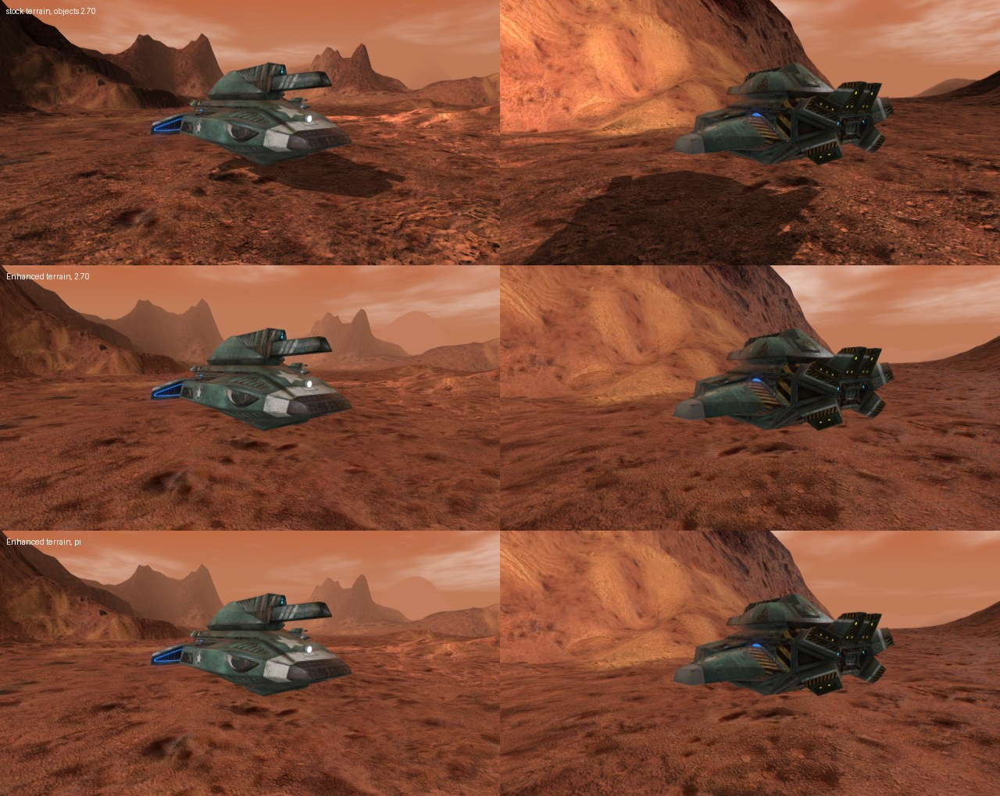

# Redux Grizzly: BZCC vs BZR Enhanced shading gap

Status: investigation plus prototypes (roughness mapping; environment term,
terminator and sharpening; per-planet environment maps). Date: 2026-10-22.

## Question

The Redux Grizzly (`avtank.mesh`, material `avtank00`) looks noticeably better in
BZCC (Steam BZ2R, BZCC-R config, `BZCC-Redux-Grizzly` addon) than in BZR's DX11
Enhanced path. Why, and what shader/lighting changes close the gap?

Reference shots:

- BZCC: `BZCC-Redux-Grizzly/screenshots/grizzly_ivtank_override_*.png`
- BZR before/after: `Docs/images/redux_grizzly_shading/`

The full BZCC decode (objects, terrain, water; all 1,179 programs) is in
[bzcc_shader_reference/](bzcc_shader_reference/README.md).

## How the comparison was made

- BZR: `resources/renderer/enhanced/openshim_enhanced_base-sm4.hlsl` (the `OSE_*`
  object programs; CR's `CR_BZBase` binds to the same code) read directly, with
  the defines from `openshim_enhanced_base.program`.
- BZCC: the shipped compiled object pixel shaders
  (`dx11_default_psh_0pdtnesl`, `..._0pdtneslzo`) disassembled with
  `fxc -dumpbin`. No decompiler output is committed; the formulas below are
  paraphrased from the instruction stream.
- Inputs: GOG `avtank.material` (`$specular .7`, `$shininess 127`, DXT1 diffuse /
  normal / spec / emissive) vs the BZCC baked `ivgrzr00` material (diffuse 0.8,
  specular 0.2, specularPower 38.44, BC1-sRGB colour maps, BC5 normals).

## Both pipelines are linear-light, untonemapped

BZCC samples sRGB texture formats (DXGI 72), so its lighting is linear and the
swap chain encodes. BZR Enhanced decodes COLOR textures in-shader
(`OSE_LINEAR_LIGHT=1`) and encodes once at output. Neither applies a tone map,
and both use radial smoothstep-style fog. **Tone mapping, gamma and fog are not
the gap.**

## Findings, ranked by visual impact

### 0. Outside CR missions, the stock Grizzly never reaches Enhanced

Captured 2026-10-22 on the GOG install, stock `lcbmars.bzn`, Enhanced profile.
The scheme rewrite requests `en-high-pssm`. Stock `BZBase.material` has no
`en-*` technique, so OpenShim's enhanced scheme fallback uses the stock
`high-pssm` technique: `BaseHighPSSM_fragment` (`MAX_LIGHTS=8`, no
`ENHANCED_MODE`, no `OSE_LINEAR_LIGHT`, no IBL). That is gamma-space Blinn-Phong.

Only CR's `CR_BZBase` routes stock names to `OSE_Base*`, and CR (mapType
campaign / instant_action) is mounted only while one of its missions is being
played. So in stock missions none of the Enhanced findings below apply yet.
Making stock materials use Enhanced in every mission is being built separately
(`Docs/ENHANCED_RENDERER_MATERIAL_OWNERSHIP.md` Phase 1/2).

### 1. Specular lobe is ~15x too narrow (fixed in the prototype)

`legacy_shininess_to_roughness` returned `sqrt(2/(n+2))` and `distribution_ggx`
then squared it again into alpha. So the Grizzly's shininess 127 became
alpha = 2/(n+2) = 0.0155, clamped to the 0.12 perceptual floor -> alpha 0.0144.
Walter's Blinn-Phong->GGX equivalence (and BZCC's own shader) is
alpha = sqrt(2/(n+2)) = 0.125 for n = 127.

Effect: a pinpoint highlight peaking around 23x light intensity (it clips to
white and sparkles under motion), while the rest of the hull gets almost no
specular. BZCC's Grizzly works out at alpha ~0.22 and its sheen is a broad,
soft, Fresnel-driven lobe.

BZCC detail: alpha^2 = 2/(2^(specTex.a * matSpec.w) + 2). DXBC `exp` is base 2,
so the CPU stores log2(specular power) and this is exactly the Walter mapping.
For the Grizzly's specularPower 38.44 (about 5.26 in log2, at full spec alpha)
that gives alpha ~0.22. A frame capture confirms the encoding: terrain
SpecularPower 1024 is uploaded as `.w` = 10.0.

Prototype fix: return `sqrt(alpha)` so the squared value in the distribution is
the Walter alpha. Shininess 127 -> perceptual 0.354 (alpha 0.125); stock
`BZBase` shininess 32 -> 0.493 (alpha 0.243). The existing min/max clamps and the
normal-variance widening are unchanged. Only the object shader changes;
`openshim_enhanced_terrain-sm4.hlsl` has its own copy of the function, and
terrain shininess was tuned separately.

Risk: low. Every Enhanced object material gets broader, dimmer-peaked highlights.
Materials that were hand-tuned to a high shininess for a "wet" look will read
softer. CR's `CR_*` fork still has the old mapping, so
`scripts/Compare-EnhancedShaderParity.ps1` will flag the divergence until CR
picks up the same change.

### 2. No real environment term on the stock path

BZCC samples a per-world prefiltered sky sphere map
(`Worlds/*/Sky/*_environ.dds`, sRGB) along the reflection vector. The mip is
chosen from gloss, it is weighted by an analytic (Lazarov-style) EnvBRDF, tinted
by `g_EnvironmentColor`, and faded to the map average for downward reflections.
This is where the planet-coloured sheen on the BZCC hull comes from.

BZR's stock Enhanced programs do not define `IBL_ENABLED`. The fallback adds
only `sceneAmbient * fresnel * (1 - rough) * 0.2`. CR's `CR_static_ibl.program`
turns IBL on, but with neutral grey static cubemaps at 0.20/0.25 intensity and
only an 18% scene tint, so it reads as a flat grey reflection.

Recommendation, in order of effort:

1. Port BZCC's analytic EnvBRDF and use it in the non-IBL fallback with a
   hemisphere colour built from sky (fog/ambient) above and ground-ish ambient
   below. This is cheap and needs no new assets.
2. Raise the scene tint in the IBL path to ~0.6-0.8 so the cubemap takes the
   planet's colour.
3. Per-planet environment maps (bake from the skydome, or reuse BZCC's sphere
   maps where licensing allows), selected per world like BZCC.

### 3. Ambient and light colours: at parity (withdrawn after capture)

Under `OSE_LINEAR_LIGHT`, the engine RGB constants (`sceneAmbient`,
`lightDiffuse`, `lightSpecular`) are passed through unchanged, while textures
and fog are decoded. A RenderDoc capture of BZCC shows it does exactly the
same. Ambient, sun, light and material colours are uploaded raw as v/255, and
only fog is decoded with pow 2.2 (see the
[capture answers](bzcc_shader_reference/README.md#cpu-side-state-renderdoc-capture)).
So no ambient decode or calibration is needed to match BZCC. This settles the
open question in `Campaign-Reimagined/Docs/DX11_COLOR_SPACE_AUDIT.md` in favour
of today's behaviour.

The remaining ambient difference is that BZCC multiplies ambient by
`(1 - EnvBRDF)`, which darkens ambient on grazing, reflective faces. Adopt that
together with finding 2.

### 4. Diffuse is normalised ~14% darker

BZR's diffuse is `2.7/pi = 0.86 * L * NdotL * (1 - F)`. BZCC has no 1/pi, so it
uses 1.0. The direct sun on the hull is about 14% dimmer in BZR. Raising
`OSE_PBR_DIFFUSE_COMPENSATION` to pi would match, but terrain must move with it
(the terrain shader has its own constant), or vehicles will float visually.
Do it together with finding 3, since both change the overall exposure.

### 5. Normal-map sharpening amplifies DXT1 block artefacts

BZR multiplies normal-map XY by 1.85 at close range (`sharpen_normal_map`).
The GOG normals are DXT1, so this sharpens block noise as much as detail, and the
normal-variance filter then adds up to 0.35 roughness to hide it. BZCC uses BC5
two-channel normals with reconstructed z and no sharpening.

Recommendation: drop the factor to ~1.2-1.3 for objects. Longer term, re-encode
Redux normals to BC5 (an asset change, outside this repo's shaders).

### 6. No terminator softening on the geometric normal

BZCC multiplies each light by `smoothstep(saturate((geomN.L + 0.1) * 10))`, so
normal-mapped detail cannot light faces that point away from the sun. BZR has
nothing like it, so faces past the terminator get speckled with normal-map
highlights. Cheap to add: one dot product per light.

### 7. At parity, or not the cause

- Fog: both radial and smoothstep-shaped.
- Tone map: neither has one.
- Shadows: BZCC shadows only the first light. BZR's shadow floor
  (`shadow * 0.78 + 0.22`) is a little brighter, which is a style choice.

## Suggested order of work

1. Roughness mapping (prototype 1).
2. EnvBRDF and a tinted hemisphere fallback (finding 2.1), with ambient
   `(1 - EnvBRDF)` (finding 3, second half). Done in prototype 2.
3. Normal sharpening down, plus the terminator smoothstep (findings 5 and 6).
   Done in prototype 2.
4. Exposure pass: diffuse normalisation for objects and terrain together
   (finding 4). Ambient stays undecoded (finding 3). Also check that the
   Enhanced colour and normal samplers use 16x anisotropic filtering like BZCC,
   and that MSAA is on: BZCC renders FP16 at 8x MSAA with no post stack. Done; see "Exposure pass" below.
5. Per-planet environment maps (finding 2.3). Done for IBL materials; see
   below.

Steps 2 and 3 should each get a before/after capture with the recipe below.
Step 4 needs a terrain parity check as well.

## Prototype results

Shots are in `Docs/images/redux_grizzly_shading/`. They come from the GOG
install on stock `lcbmars.bzn` (Mars, sun time 0900, fog 120-250) with the
Enhanced profile, captured by `reverse_engineering/capture_grizzly_reference.ps1`.

- `bzr_enhanced_before_*.jpg` show the stock material. The Grizzly falls back to
  stock `BaseHighPSSM_*` (finding 0).
- `bzr_ose_before_*` / `bzr_ose_after_*` are the A/B pair. For these runs only,
  CR's `avtank.material` and a trimmed `CR_BZBase.material` were overlaid into
  `BZ_ASSETS\pc\materials`, so the Grizzly took the `en-high-pssm` pass
  (`OSE_BaseENHighPSSMV2_vertex` / `OSE_BaseENHighPSSM_fragment`). The trim removed
  the CR-only `CR_BaseIBL*` overrides and renamed `CR_Textured_*` to `Textured_*`.
  The only difference between A and B is `legacy_shininess_to_roughness`. The
  shader cache was set aside, and its fingerprint changed, so the shaders
  recompiled. Every install file was restored and hash-verified afterwards.
- `bzr_ose_ab_*_crop3x.png` show the tank at 3x, before on the left and after on
  the right.

Result: the hot white glint along the turret rim and top edges becomes a
broader, softer sheen. In the `front_close` tank crop, pixels with luminance
above 150 fell from 1688 to 650 while mean luminance barely moved (68.7 to
68.5), so the energy is spread out rather than removed. This narrows the
biggest single gap. The planet-tinted environment sheen BZCC shows (finding 2)
is still missing.

## Prototype 2: environment term, terminator and normal sharpening

Branch `agent/enhanced-env-brdf`, stacked on the roughness fix. It covers
suggested-order steps 2 and 3, all in `openshim_enhanced_base-sm4.hlsl`:

- **EnvBRDF.** `bzcc_env_brdf` is BZCC's analytic EnvBRDF with the constants
  from [objects.md](bzcc_shader_reference/objects.md). Gloss is
  `log2(power)/10`, recovered from our roughness, the same way BZCC encodes
  `matSpec.w`.
- **Hemisphere fallback.** The non-IBL Enhanced path (every `OSE_BaseEN*`
  specular variant) replaces `sceneAmbient * fresnel * (1 - rough) * 0.2` with
  `hemisphere(worldReflection.y) * EnvBRDF`.
  - Above the horizon the hemisphere uses the linear fog colour, which is
    already per-world. Below, it uses ground, which is
    `0.15 * sky + 0.5 * ambient`.
  - The blend width depends on gloss, and the whole term is scaled by 0.5.
  - It is not shadowed and not multiplied by albedo, as in BZCC.
  - This needs `inverseViewMatrix` on the nine `OSE_BaseEN*` HLSL4 fragment
    programs.
- **Ambient.** Ambient becomes `ambient * (1 - EnvBRDF)`, as in BZCC.
- **F0 for the environment.** The environment term uses `F0 * 0.45`.
  `legacy_specular_to_f0` reaches 0.45, while BZCC's F0 (`matSpec *
  specTex`) is at most 0.2 on the Redux Grizzly.
- **Terminator.** On normal-mapped variants, each light (diffuse and specular)
  is multiplied by `smoothstep(sat((Ngeom·L + 0.1) * 10))`.
- **Normal sharpening.** The factor drops from 1.85 to 1.25.

The CR IBL path (`IBL_ENABLED`) is unchanged here. Per-planet maps for it are
described below. The sm3, GLSL and terrain shaders are unchanged.

Tuning, on the same `lcbmars` A/B recipe as prototype 1, with the stock
Grizzly on `en-high-pssm`:

| Run | Hemisphere scale | Ground | Env F0 | Result |
|---|---|---|---|---|
| B | 1.0 | 0.30 sky + 0.5 ambient | ×1 | Milky orange haze over the whole hull |
| C | 1.0 | as B | ×0.45 | Almost the same as B. The grazing EnvBRDF term, which doesn't depend on F0, dominates against the dark green albedo |
| D (kept) | 0.5 | 0.15 sky + 0.5 ambient | ×0.45 | Hull stays green. Upward-facing panels pick up a faint Mars sheen, and faces past the sun darken |

Left is prototype 1, right is prototype 2 (run D). Full frames are
`bzr_env_before_*.jpg` and `bzr_env_after_*.jpg`. In the tank crop, mean
sRGB moves from (87, 66, 54) to (93, 68, 56) and saturation from 39.7 to 40.8.
The sheen is additive but small. The clouds move between runs, so compare the
tank only.

## Per-planet environment maps

Every Enhanced IBL material samples the same pair of neutral cubemaps,
`openshim_ibl_neutral_{prefilter,irradiance}.dds`, so a Grizzly on Mars
reflected a grey sky. This change adds one baked pair per world and swaps it
in at runtime. This covers finding 2.3.

**Bake.** `tools/ibl/bake_planet_env.py` writes
`resources/renderer/enhanced/openshim_env_<code>_{prefilter,irradiance}.dds`
for the nine worlds (mn ma ve io eu ti ga ac el); see `tools/ibl/README.md`.
For each world it builds a 1024x512 linear equirect radiance map from the
stock sky textures, cloud layers, fog colour and the terrain atlas mean for
the lower hemisphere. It then runs the GGX prefilter and cosine irradiance
from CR's `Generate-StaticIBL.py`. The cubes keep the neutral sizes and BC1
format. The irradiance cube now carries a full mip chain. The 18 files total
630 KB.

**Runtime.** `src/patches/planet_environment.cpp` does the swap:

- The file-open hooks record the world code when the engine opens
  `<code>_detail_atlas.csv`.
- A render-frame tick applies a pending change once the neutral cubes exist.
  It retries every 30 frames, up to 40 attempts. The mission seam alone isn't
  enough: a session that boots straight into a mission never sees a
  RUN_STARTED transition, and the textures load after it.
- The swap needs Enhanced on Direct3D 11. It finds each neutral texture
  through Ogre's `TextureManager`, snapshots it once into a backup, and copies
  the planet file in with `CopySubresourceRegion`.
- A world with no file gets the neutral contents back from the backup.
- Every D3D11 call is SEH-guarded and fails closed. One line per change is
  logged under `planet-env`, for example
  `[PLANET-ENV] world=ma prefilter=applied irradiance=applied`.

Ogre loads both neutral cubes with its default of 6 mip levels. That means
128..4 px for the prefilter, which drops the file's 2 px and 1 px levels. The
32 px irradiance, which has 1 mip on disk, gets expanded to 6. So the copy
uses the destination's mip count, and a planet file needs at least that many
mips. The roughest prefilter levels are clamped the same way for the neutral
map; this was already the case before this change.

**Result.** The same `lcbmars` recipe was run with CR's `CR_BaseIBL` tank
material active through a test overlay (CR's `CR_BZBase.material` and
`CR_static_ibl.program` plus the OSE HLSL files in `pc/materials`). N is the
neutral cube and P the Mars pair.

On the right, the hull takes a rust tint from the Mars sky and ground, and
faces turned away from the sun lose the grey lift.

| Crop | Mean sRGB, N | Mean sRGB, P | Saturation, N → P |
|---|---|---|---|
| Front | (85, 62, 51) | (85, 59, 47) | 39.4 → 40.1 |
| Rear | (86, 57, 43) | (77, 48, 34) | 46.8 → 44.1 |

The rear crop includes the cliff behind the tank. Its brightness change is
mostly a passing cloud shadow, not the swap: CR's terrain IBL programs didn't
compile in this overlay, so terrain stays on the non-IBL path. Full frames
are `bzr_ibl_{neutral,planet}_*.jpg`.

### Other worlds

The same recipe was run on `lcbio`, `lcbachil` and `lcbtitan`. Every run
logged `prefilter=applied irradiance=applied` for its world.

Rows from top: Io, Achilles, Titan. Neutral is on the left, the planet map on
the right. Full frames are `bzr_ibl_np_<mission>_grid.jpg`.

| World | Mean sRGB, N | Mean sRGB, P | Mean abs. difference |
|---|---|---|---|
| Io | (55, 33, 27) | (52, 30, 24) | 2.8 |
| Achilles | (54, 57, 47) | (54, 57, 46) | 1.0 |
| Titan | (66, 45, 29) | (64, 42, 24) | 3.5 |

What the shots settled about the bake:

- **Io.** The first bake guessed an 18° Jupiter disc at 40° elevation. In game,
  `SkyType=1` stretches `jupiter.map` once over a sky plane centred on the
  zenith. The banded disc then fills the sky down to about 20° elevation in
  every direction, with black below. The bake now does the same
  (`SKYTYPE1_HALF_EXTENT`). With the first bake the hull went darker than
  neutral (difference 4.4); with this one it keeps more light on upward faces
  (difference 2.8).
- **Achilles.** It is not too bright. Its pale grey-green sky is close to the
  neutral map, so the swap barely shows.
- **Titan.** The orange sky warms the hull. In game, Saturn hangs about 15°
  above the horizon. The bake leaves billboards out on worlds that have a
  sky texture; at that size the effect on lighting is small.
- **Azimuth convention.** Only billboards (Moon, Ganymede, Europa, Elysium)
  depend on it, and it is still unverified.

The change is a tint, not a relight. The CR IBL intensities (diffuse 0.20 to
0.62, specular 0.25 to 0.82) keep the environment a minor term next to the
sun and ambient.

Limits:

- Only IBL materials see the maps. In this configuration that means CR's
  `CR_Base*IBL` materials. The stock-material redirect (#574) drops the IBL
  texture units, so stock materials keep the hemisphere fallback from
  prototype 2, which is tinted by fog and ambient. If #574 keeps those units,
  the stock path gets planet maps with no shader change.
- Moon, Venus, Europa, Ganymede and Elysium have not been captured.
- A mid-session world change has not been tested. Restoring and re-applying
  has only been exercised through the dirty-generation logic.

## Exposure pass

`OSE_PBR_DIFFUSE_COMPENSATION` is now `OSE_PI` in both
`openshim_enhanced_base-sm4.hlsl` and `openshim_enhanced_terrain-sm4.hlsl`, so the
diffuse weight is `(1 - F)` as in BZCC. Ambient is unchanged (finding 3).

Measured on lcbmars and lcbtitan (Grizzly, close front and rear, linear light,
pixels that changed between runs):

| | 2.70 to pi |
|---|---|
| Grizzly | +3 to +5% (median per pixel +4 to +8%) |
| Enhanced terrain | +9 to +10% |
| Stock terrain | unchanged (pixel-identical) |

The ceiling is +16% (pi / 2.70) on the direct sun term. The Grizzly gains less
because ambient, environment and specular make up much of its lit colour. The
ground gains nearly the full amount.

Enhanced terrain is opt-in. By default (`enhanced-stock-base=on terrain=off` in
openshim.log) stock objects get the Enhanced shader and terrain stays on the
stock shader. Set `OPENSHIM_ENABLE_ENHANCED_STOCK_TERRAIN=1` to opt in. On the
default path this change therefore brightens objects by about 4% against an
unchanged ground. That is too small to make vehicles look like they float.

The capture shows a separate problem. With Enhanced terrain on, the Grizzly
casts no shadow on the ground (rows 2 and 3), so it does look like it floats.
The stock terrain shader receives the shadow (row 1). This has to be fixed
before Enhanced terrain can be on by default. It is not caused by the diffuse
change: the shadow is already missing at 2.70.

These captures use the stock Mars atlas and heightmap. The painted HD Mars set
(`openshim_mars_painted.json`) loads but is declined on lcbmars, because its
terrain fingerprint belongs to another map.

Filtering and MSAA:

- Anisotropic filtering is at parity. At startup and when settings are applied,
  the exe calls `MaterialManager::setDefaultTextureFiltering(TFO_ANISOTROPIC)`
  and then `setDefaultAnisotropy(1 << (option - 1))`. Option 0 gives 1, which is
  plain trilinear. No OpenShim material sets `filtering` or `max_anisotropy`, so
  the Enhanced samplers follow the video option. 16x needs the top setting.
- MSAA is at parity. The test install's `ogre.cfg` has `FSAA=8` for Direct3D11,
  and the Ogre log confirms it. That matches BZCC's 8x.

## Follow-ups outside this change

- Apply the same mapping to CR's `CR_*` shader fork to restore parity.
- Decide whether terrain should adopt the same mapping. Terrain shininess values
  were tuned against the old curve.
