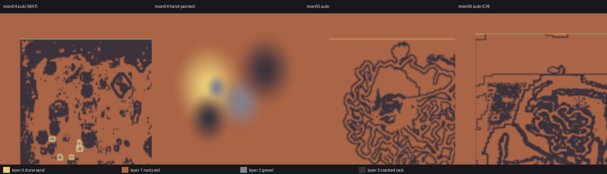
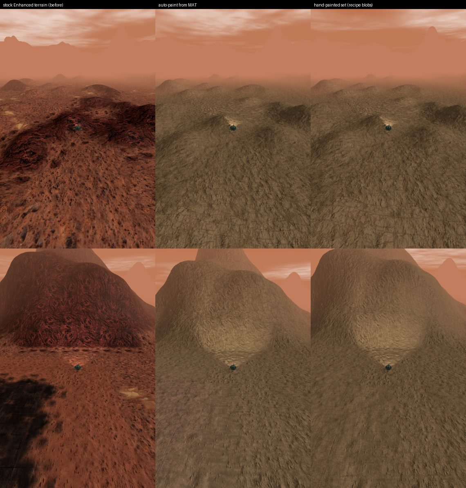
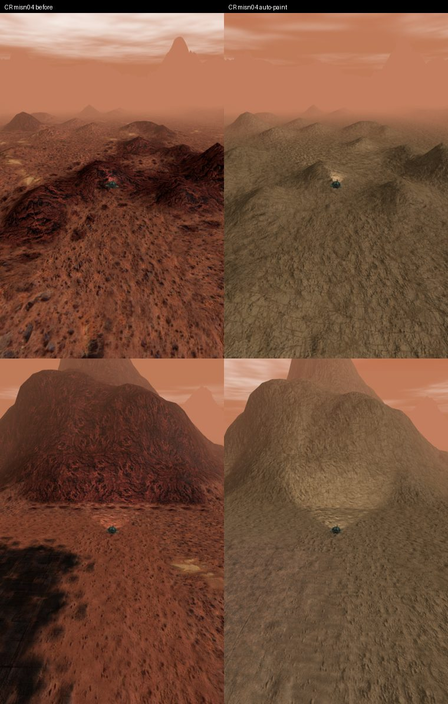
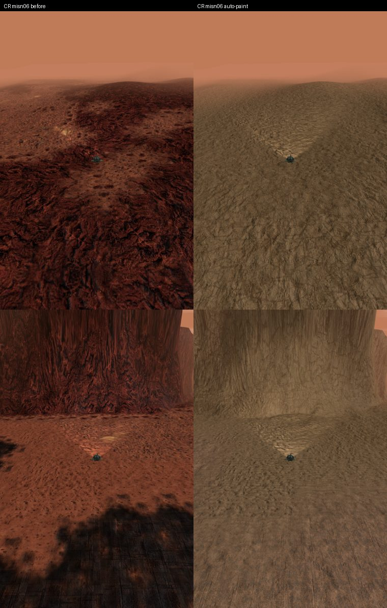

# Four-material terrain painting prototype

This experimental DX11 path blends four independent, repeating diffuse
materials across native terrain using a saved RGBA weight map. Painting is
continuous across stock tile boundaries and uses actual native vertex X/Z
positions plus cluster translation. Camera position, native tile orientation
and atlas rectangles do not determine the new diffuse coordinates.

Enable the existing **HD Terrain Tiles** option, select the generated manifest
through `[Terrain] TerrainHdManifest`, and restart. **Terrain Micro Detail**
works alongside it. The original tile-array mode remains supported.
There are no new INI keys. Stock heights, collision, indices, AI and gameplay
terrain files are unchanged. Native packed UVs are still independently audited
before installation and retained for auxiliary maps and shadow-only passes.

Paint weights can be drawn by hand (below) or **generated from each map's own
MAT tile layout** (see [Automatic paint](#automatic-paint-from-the-maps-mat-layout)),
and one manifest can carry many maps (see [Multi-map manifests](#multi-map-manifests)).

## Build and paint

1. Capture the target mission using `OPENSHIM_TERRAIN_HD_EXPORT` as described
   in [terrain-hd-tiles.md](terrain-hd-tiles.md). The updated exporter includes
   `paintMap`: native world bounds in metres, row order and a terrain fingerprint.
   Older captures without this field cannot author a paint pack.
2. Build a pack using Python and Pillow:

```powershell
python scripts/Build-TerrainPaintPack.py `
  --capture build/terrain-paint/misn04-capture.json `
  --recipe scripts/terrain-packs/mars-paint.json `
  --source-root '<your ground texture directory>' `
  --output build/terrain-paint/mars --size 2048 --weight-size 1024
```

3. Open the generated `openshim_mars_paint_editor.html` in a current browser.
   It is self-contained and works offline. Pick sand, soil, gravel or rock;
   set brush radius in metres and strength; drag to paint. The coloured view
   is a top-down weight preview with material thumbnail swatches, not a
   rendered view of the game or a heightmap. Minimum Z is the top row, and
   maximum X is the right edge. Undo/redo retains twelve strokes.
4. **Save weights PNG**, then rebuild with `--weights '<saved PNG>' --force`
   added to the command. This uses the edited weights instead of the example
   recipe strokes. The exporter normalizes all pixels to a total weight of 255.
5. Copy only the four `*_layer0..3.png` files and `*_control.png` to a registered
   Ogre resource directory, and the main manifest beside the game executable.
   Set `TerrainHdManifest = openshim_mars_paint.json`, enable HD Terrain Tiles,
   and restart the target mission. The weight source, project JSON and editor
   are authoring files and need not be installed as game resources.

The provided Mars recipe references the user's local 4K albedo ZIP members;
it contains no artwork. It starts from rocky soil and adds several broad soft
patches to demonstrate blending. It does **not** convert the mission's existing
tile layout to weights; `Build-TerrainAutoPaint.py` does. Preserve original gameplay MAT/HG2/TRN files. Artwork,
game captures and generated packages remain local and are never committed.

The adjacent project JSON records material sources/hashes, repeats, dimensions
and map identity. Repeats are independently specified for the four layers in
the recipe (`repeatMeters`). The material textures and editable paint map
have independent authoring resolutions. The browser's PNG codec stores raw
RGBA bytes: PNG alpha represents the fourth layer's weight, so ordinary canvas
export or image compositing would lose the first three channels wherever that
weight is zero. Save/load preserves those transparent RGB pixels.

## Automatic paint from the map's MAT layout

`scripts/Build-TerrainAutoPaint.py` generates the RGBA control map, the terrain
fingerprint and the bounds from the map files alone: no hand painting and no live
capture. It only reads `<map>.hg2`, `<map>.mat` and `<map>.trn`.

```powershell
python scripts/Build-TerrainAutoPaint.py `
  --recipe scripts/terrain-packs/mars-autopaint.json --source-root '<ground texture directory>' `
  --output build/terrain-paint/mars-auto --prefix openshim_mars_auto `
  --map misn04='<CR>/Missions/misn04' `
  --map misn05='<CR>/Missions/misn05.hg2,<stock>/misn05.mat,<stock>/misn05.trn' `
  --map misn06='<CR>/Missions/misn06' `
  --map misn04_stock='<stock>/misn04' --map misn05_stock='<stock>/misn05' --map misn06_stock='<stock>/misn06'
```

`--map NAME=STEM` reads `STEM.hg2/.mat/.trn`; `--map NAME=HG2,MAT,TRN` names the
three files, which is needed when a mission overrides only some of them (Campaign
Reimagined overrides `misn05.hg2` but not its MAT or TRN). `--capture NAME=FILE`
cross-checks that map against an `OPENSHIM_TERRAIN_HD_EXPORT` capture and
declines on any disagreement. The output is one multi-map manifest
(`<prefix>.json`), four layer PNGs shared by every map, one control PNG per
distinct layout (maps with identical MAT layouts share one) and, for touch-up, one
standalone editor per map preloaded with the generated weights. Install the
manifest beside the executable and the PNGs next to it, as for a hand-painted pack.
The recipe's layer art can be the same ZIP members as `mars-paint.json` or plain
`file` entries.

**Tile index to layer.** A MAT cell word holds base type (bits 15-12), next type
(11-8) and a cap/diagonal bit (7); the TRN maps `(type, kind, next, variant)` to the
atlas tile, so the atlas tile index carries no information beyond that key. The
recipe therefore maps the TRN's texture *types* to the four layers
(`typeWeights`, with `typeNames` as a guard that the TRN still means what the recipe
assumes) and blends a transition cell between its two types (`transition.cap` and
`transition.diagonal` give the next type's share). Mars: Sandy -> dune sand, Rocky ->
rocky soil, Geyser and Base -> gravel, Rock mountain -> cracked rock. Cells naming a
type the TRN never defines (stock `misn04` has nine, in its last column) take
`undefinedTypeWeights`; a layout with more than 1% such cells is declined. The
per-cell weights are rasterized into the map's world bounds and blurred with a
Gaussian (`blurMeters`, default 12 m, about half a cell) for soft transitions.
Skirt cells outside the file take `outsideWeights`.



### Native terrain frame (measured)

These facts were measured on stock `misn04` and are what the generator uses:

- File sample `(sx, sz)` sits at world `X = 5 * (sx - 128 * zonesX)` and
  `Z = -5 * (sz - 128 * zonesZ)` metres. **Rows run toward -Z**: HG2/MAT row 0 is the
  most positive Z of the file. An `OPENSHIM_TERRAIN_GEOMETRY_EXPORT` snapshot of one
  zone matched the HG2 heights at all 66,049 of its vertices for exactly this
  mapping, and for no sign or offset variant around it. The first auto-paint draft
  assumed rows ran toward +Z; the snapshot caught it.
- The engine builds a `(zonesX + 1) x (zonesZ + 1)` grid of 256-sample zones. Zone
  `i` starts at file sample `256 * i - 128` and its mesh vertices begin two samples
  (10 m) later, so a MAT cell `c` covers mesh samples `4c + 2 .. 4c + 6`. Samples
  outside the file read as zero. Stock `misn04` therefore has 20 zones and bounds
  `-3190, -2570, 3210, 2550`; the general bounds are `5 * (-126 - 128 zx)`,
  `-5 * (130 + 128 zz)`, `5 * (130 + 128 zx)`, `5 * (126 + 128 zz)`.
- MAT cells align with the HG2 sample grid (cell `c` is sample `4c`): the correlation
  between MAT rock cells and height slope is 0.69 at zero offset and 0.31 if the rows
  are flipped.
- Mission files are looked up by the name inside the BZN (`TerrainName` in a text
  BZN, the embedded mission name in a 1.5-era binary one), not by the launch
  argument. A test mission with its own terrain files needs a text BZN naming them.

### Offline fingerprint

`terrain_fingerprint()` reproduces `CaptureTerrainPaintMap()` from the HG2: FNV-1a
over the zone count, then for each zone in `(x, z)` order its coordinates and its
256 x 256 13-bit height samples (row-major, zero outside the file). It matches the
in-game value for stock `misn04` (`73f9729303821983`, the hand-painted pack's
fingerprint), confirmed again by a live capture (`zoneCount` 20, same bounds). No
game launch is needed to author a pack for a map whose HG2 is at hand. The sample
storage origin is still excluded, as in the runtime.

The hash covers every height, so **Campaign Reimagined's own HG2s have different
fingerprints from stock** even though their MAT/TRN may be identical. A pack built
for stock `misn04` declines on the CR campaign mission (the guard working); list
both versions as separate map entries.

| Map | Zones | Stock fingerprint (live) | CR fingerprint (live) |
|---|---|---|---|
| `misn04` | 4x3 | `73f9729303821983` (matches offline) | `cd7f44e80ffb7fc1` (matches offline) |
| `misn05` | 3x3 | `04e39ffb0e80a25e` (offline `087ff2851a95085e` **disagrees**) | `5e4ef40b581c2c36` (offline `b239c56fe89ebe36` **disagrees**) |
| `misn06` | 4x4 | `9c77ccbdec3593fe` (matches offline) | `47910f1f7563463d` (matches offline) |

The offline model reproduces four of the six maps. For `misn05` the bounds and
zone count (16) match the live capture but the hash does not; the cause is not
found (a 3x3 file is the only odd-sized one; a brute-force search over zone and
sample offsets did not reproduce it). `--capture NAME=FILE --trust-capture` uses
the live values for such a map, which is how `misn05` is packed here. Reading the
live map from the decline message (it prints the actual fingerprint and bounds) or
capturing once with `OPENSHIM_TERRAIN_HD_EXPORT` is the fallback.

### In-game results (GOG, DX11 Enhanced, `OPENSHIM_ENABLE_ENHANCED_STOCK_TERRAIN=1`)

Test missions were minimal text BZNs with the map's own terrain files and a Lua
driver that teleported the player and parked a chase camera, so each run shows
three spots. Before = HD tiles off; after = the generated multi-map pack.

| Mission (terrain files) | Selected entry | Result |
|---|---|---|
| stock `misn04` | `73f9...` | painted; also compared with the hand-painted set |
| CR `misn04` | `cd7f...` | painted |
| CR `misn06` | `4791...` | painted |
| stock `misn06` | `9c77...` | entry selected; shots not inspected |
| stock and CR `misn05` | none | pack declined (offline fingerprint wrong); the packed live values were **not** re-run in game |





What the shots show: paint boundaries follow the stock layout (pale sand patches
and cliff/rock faces sit where the stock tiles put them), the selection logic
binds the right entry, and the runtime logs `multi-map entry selected` for each.
They do not show parity of look: the four recipe layers share one brown palette,
so the stock atlas's dark and red rock tiles become a similar brown. That is an
artwork choice (layers 2 and 3 need darker albedo to carry the stock contrast),
not a layout error. The "hand-painted" Mars set is the recipe's demonstration
blobs, not a map-specific paint, and at these spots it is visually close to the
auto result; no quantitative comparison was made. Pre-generated outputs
(manifest and control maps, no artwork) are in
`scripts/terrain-packs/generated/mars-auto/`; the layer PNGs are local.

Existing tooling: CR's `Build-MarsHdTileSources.py` / `Build-MoonHdTerrain.py` and
the Toolbox `hd_tiles.py` author per-tile v2 packs, a different runtime format;
none derives paint weights or fingerprints from MAT/HG2, so this script reuses only
OpenShim's own `Build-TerrainHdPack.py` and `Build-TerrainPaintPack.py` helpers.

### Extending to other worlds

1. List the world's campaign missions in `Config/crcampgn.ini`; the TRN's
   `[Atlases] MaterialName` (for example `ve_detail_atlas`) is the manifest material
   key, so one manifest can hold every world as a separate `materials` entry.
2. Copy `scripts/terrain-packs/mars-autopaint.json`: set `diffuseResource` to the
   world's atlas diffuse texture, `typeNames` to the TRN `[TextureTypeN]` comments
   and `typeWeights` to the four layers that best match each type. The script
   declines a TRN whose type names differ from the recipe, so a new world cannot
   silently get Mars' mapping.
3. Run the script over every mission of that world, both the stock and the CR copy
   of the HG2 where they differ, and merge the `materials` entry into the shared
   manifest. Confirm one map per world live (the `[TERRAIN-PAINT] map accepted
   fingerprint=...` log line prints the live value, or use
   `OPENSHIM_TERRAIN_HD_EXPORT` and `--capture`) before trusting the offline
   fingerprint for the others.
4. The layer artwork is the only per-world creative input. A TRN with more than four
   visually distinct materials needs a `typeWeights` that folds some together; four
   layers is the runtime limit.

## Multi-map manifests

Several campaign missions share one atlas material (`MA_DETAIL_ATLAS` for all of
Mars), so a one-fingerprint manifest could only ever cover one of them. `paint` may
now carry a `maps` table instead of a single `terrainFingerprint`/`boundsMeters`:

```json
"paint": {
  "schema": "bzr-openshim-terrain-paint-v1",
  "rowZero": "minZ",
  "repeatMeters": [24, 16, 12, 24],
  "maps": [
    {"terrainFingerprint": "73f9729303821983", "boundsMeters": [-3190, -2570, 3210, 2550], "control": "mars_misn04_control.png"},
    {"terrainFingerprint": "087ff2851a95085e", "boundsMeters": [-2550, -2570, 2570, 2550], "control": "mars_misn05_control.png"}
  ]
}
```

`tiles` still lists exactly five slices; slice 4 names the default control image.
At install the runtime computes the live fingerprint and bounds (unchanged) and
binds the control image of the entry matching **both**; no entry means the whole
pack declines before binding anything and the stock atlas stays. The layers, the
five-slice array size and every other guard are unchanged, and the single-map form
still works. Log lines: `[TERRAIN-PAINT] multi-map entry selected fingerprint=...
control=...`, or on a mismatch the decline message with the live map. Entries must
be unique per fingerprint and bounds; at most 64. Unit tests cover selection and
validation.

## Runtime format and guards

Paint extends `bzr-openshim-terrain-hd-v1` material bindings with:

```json
"paint": {
  "schema": "bzr-openshim-terrain-paint-v1",
  "terrainFingerprint": "0123456789abcdef",
  "boundsMeters": [-3200, -2560, 3200, 2560],
  "rowZero": "minZ",
  "repeatMeters": [24, 16, 12, 24]
}
```

The illustration's fingerprint/bounds are placeholders; use the live capture.
Exactly five explicit slices are required: four material images then one RGBA
control image. The diffuse-resource identity guard is mandatory. Canonical
zone coordinates and every native height sample contribute to a 64-bit FNV
map fingerprint. This is an accidental
misapplication guard, not a security hash. Native sample-storage origins are
excluded because the engine can relocate them between launches. World bounds
must also match exactly.
A mismatched mission, incompatible layout/resource or unknown shader declines
before binding the replacement. Editing terrain heights requires a fresh
capture and regenerated manifest. Runtime dirty mesh rebuilds refresh position
streams; painting requires rebuilding the pack and restarting the game.

## Current limits

This is diffuse-only painting with the stock lighting pipeline. Normal,
detail and specular maps retain their stock atlas coordinates, and materials
are blended before the stock colour-space processing. Diffuse repetition is
explicit, with
UV gradients taken before wrapping so repeat boundaries do not select
incorrect mip levels. Material height assets,
height-based blending and physically based material maps are future work.
The bounded procedural micro relief remains separate from the paint layers.

The initial implementation packs control weights into slice 4 of the same
texture array to reuse the validated native binding/upload/lifetime path.
All five uploaded slices therefore share resolution and mip count. A
1024-pixel source weight map is upscaled for a 2048-pixel material pack; this
does not add painting detail. Control sampling uses level zero and a half-texel
edge clamp to prevent wraparound with the shared repeating sampler. Separate
control textures, mip-aware control sampling and streamed map pages remain
future improvements. Five 2048-pixel RGBA8 slices with full mips cost about
107 MiB, plus source caches and the existing native semantic streams.

The editor is a standalone authoring prototype. It has no game camera view,
terrain contours, WorldBuilder integration, in-game brush or live reload.
It supports four layers at a time and square 64..2048-pixel weight maps.
It renders rectangular world bounds stretched into its square top-down view;
brush distance is still calculated in world metres. A single-map pack targets one
terrain shape; a multi-map pack selects among listed shapes. Steam, Proton/Wine, broad editor/mission lifecycle,
artistic acceptance and performance qualification remain unverified.

Automated checks cover the pack contract, soft brushes, normalized weights,
source boundaries, raw PNG channels, map/coordinate contracts, preserved
auxiliary UVs, native `ps_4_0` compilation and WARP readback of four-layer
blending, zero-weight fallback, opaque output and map-edge clamping.

For the optional offline browser qualification, install Node.js and Playwright,
then run `node tests/terrain_paint_editor_browser_tests.js <editor.html>
<ignored-output-directory> [browser.exe]`. It verifies an actual brush stroke,
PNG download, exact undo/redo and PNG reload through a headless browser. The
regular CTest suite does not require a browser or proprietary textures.

Local GOG DX11 qualification on 2026-10-04 installed the 2048-pixel five-slice
paint array on all 320 `misn04` meshes and 27 diffuse passes (PID 34616).
A factor-4 micro-relief run recorded 243,200 domain invocations and 1,638,013
pixel invocations on an observed terrain draw, then restored all 320 streams,
27 passes and 320 padded bounds. The independently launched `misn05` editor
(PID 23928, 256 meshes) rejected the pack's geometry fingerprint before array
creation; stock terrain remained and exit was clean. The positive-only harness
reported failure for this deliberate rejection, as expected. An earlier
`misn05` launch stayed in briefing and did not qualify.

All 80 CTest entries passed, including seven paint-pack authoring cases,
the raw PNG codec, portable coordinate/configuration checks and GPU blending.
An offline headless Edge run exercised real brush input, PNG downloads,
exact undo/redo and reload; Pillow independently confirmed that RGB weights
survived zero PNG alpha. Desktop game screenshots could not be captured
because the Windows capture API reported desktop composition disabled;
broad in-game artistic/seam and camera-motion acceptance remains open.

During development, a live dump identified inconsistent JSON serializer
argument code in an incremental LTCG binary. A clean rebuild/full link removed
the crash; final runs used a full link. Keep this evidence separate from the
Windows commit-limit failure during an earlier startup. The shape fingerprint
excludes stock material words, which varied across fresh launches despite
identical height data, as well as the engine's sample-storage relocation bias.

The browser-edited PNG was rebuilt into a second 2048-pixel pack and submitted
on `misn04` in a fresh process (PID 52140), with flat factor-2 tessellation and
micro relief disabled. All 320 streams and 27 passes installed and restored,
the geometry fingerprint matched again, and an observed draw recorded 89,600
domain invocations with rasterized pixels. This qualifies the saved-brush-PNG
to rebuilt resources to native game submission path; it is not visual artistic
acceptance.
